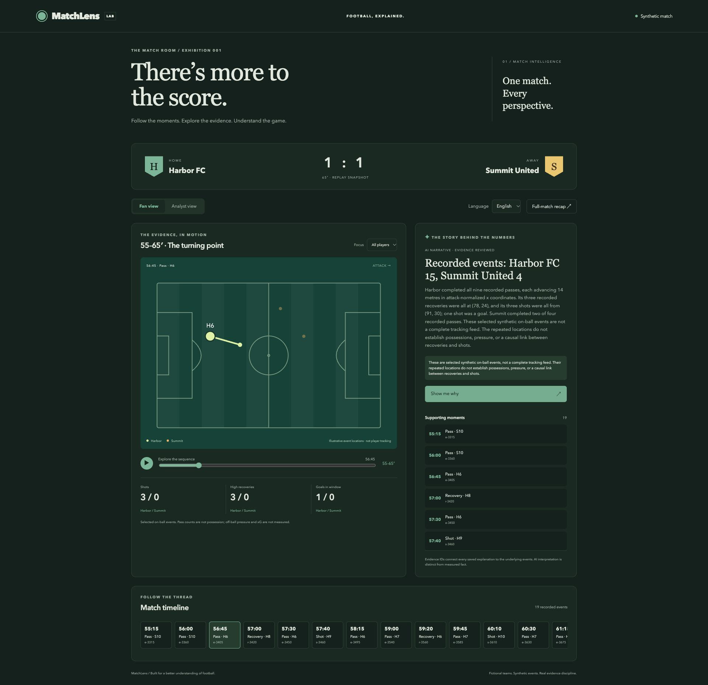

# MatchLens

An evidence-first football match room: an interactive pitch, event replay, exact statistics, and reviewed AI narratives. Built with the **OpenAI Agents SDK**, **MCP Apps**, and **Azure**.

**[Watch the 1:53 demo](https://www.youtube.com/watch?v=qdtIEEIp8bE)** · **[Open the live demo](https://matchlens-dev.redforest-787f42f7.westus2.azurecontainerapps.io)** · **[Open the private ChatGPT plugin](https://chatgpt.com/plugins/plugins_6acfdfe899388191af6dc5741e611de1)**



This demonstration uses fictional Harbor FC and Summit United and deterministic synthetic events. It contains no licensed Premier League feeds, real player tracking, betting predictions, or Dhisana customer data.

[Judge’s three-minute walkthrough](docs/judge-guide.md) · [Release review](docs/competition-review.md)

## Run locally

Python 3.12 required.

```sh
python3.12 -m venv .venv
. .venv/bin/activate
pip install -r requirements.lock
pip install -e . --no-deps
uvicorn matchlens.app:app --host 127.0.0.1 --port 8000
```

Open http://127.0.0.1:8000. MCP endpoint: http://127.0.0.1:8000/mcp.

```sh
pytest -q
ruff check matchlens tests
```

## How the agents work

The live demonstration ingests six synthetic event batches, including duplicate and late arrivals, a reported goal and its correction. Exact Python statistics update before AI review. Four Agents SDK roles select the story, challenge its evidence, adapt it for fans/analysts in English/Spanish, and verify every localized narrative. Rejection triggers one correction attempt; persistent failure publishes statistics without a stale story.

The intelligent UI selects a pitch, comparison or correction timeline from the approved analysis. Replay **frame 4** to see the reported 1–0 score, then **frame 5** to see its retraction to 0–0 and revised evidence. Frame numbers in tool arguments are zero-based; the UI labels moments 1–6. The full-match exhibition is a separate saved example.

Generation runs in an authenticated, manual Azure Container Apps job with an exclusive publication lease and per-run token/call limits. The public service can only read synthetic records; watching never triggers paid model calls. Runs retain evidence, handoffs, rejected attempts, latency and usage. Download the current synthetic ledger from `/api/run`.

For local generation, set `AZURE_OPENAI_ENDPOINT` and `MATCHLENS_MODEL` to the Azure deployment name. Use an identity with inference permission or supply `AZURE_OPENAI_API_KEY` through your secret manager. Then run:

```sh
python -m matchlens.worker --seed 7 --interval 2
python -m matchlens.evaluate
```

Both commands make paid calls. They do not load `.env` automatically. Run them sequentially to avoid competing for model quota. Responses use `store=False`; SDK tracing is disabled. The worker waits for review between accelerated batches, so this is not a subsecond broadcast feed. See [architecture and limitations](docs/architecture.md), [verification](docs/verification.md) and [submission gates](docs/submission-readiness.md).

## Clients

- **ChatGPT:** MCP Apps resource renders the interactive match room. Connect the hosted `/mcp` endpoint using an account that supports custom apps, or install the private MatchLens plugin.
- **Claude Code:** HTTP MCP tools provide structured and text results. Its terminal does not render this embedded UI; open the web app for the pitch.
- **GitHub Copilot in VS Code:** MCP tools, with interactive rendering in supported MCP Apps clients.
- **Microsoft Copilot Studio:** connect the Streamable HTTP server as an MCP tool. Text/tool compatibility is provided; the ChatGPT UI is not assumed to render in every Copilot surface.

See [connection instructions](docs/connections.md), [current SDK research](docs/research.md), and [Azure operations](docs/azure.md).

## Boundaries and next steps

This is a working synthetic-data demonstration, not a production match-data service. Real feeds need licensing, ingestion, provenance and retention controls. Authenticated tenant data needs OAuth and authorization before exposure. Arbitrary live questions need an authenticated generation job, rate limits and a budget policy. Keep future Dhisana integration behind an adapter; this repository and Azure resource group are independent.

For a running server, execute `python scripts/smoke.py <MCP URL>`. To exercise the embedded bridge locally, start the app on port 8767 and run `python scripts/ui_harness.py`, then open http://127.0.0.1:8788. The harness is not included in the Azure image and does not substitute for acceptance testing in actual client products.
