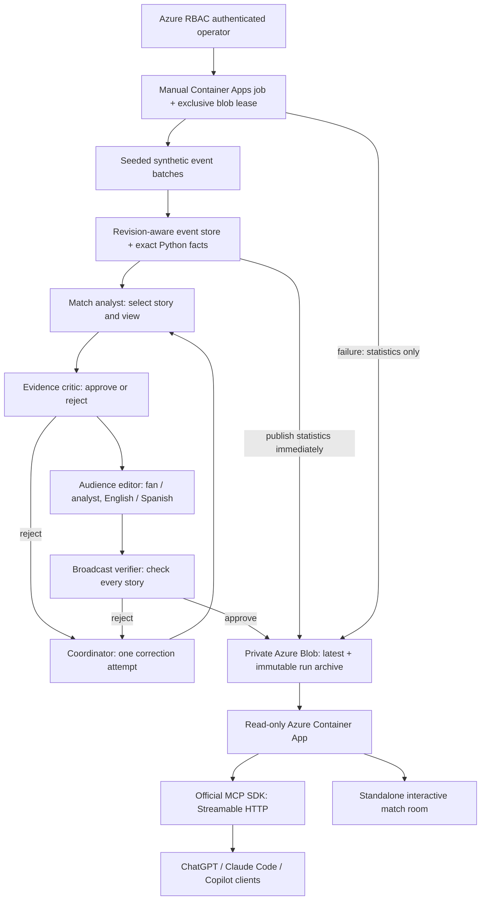

# Architecture

The authenticated worker uses the OpenAI Agents SDK and Azure OpenAI. Four distinct roles share an immutable, revision-specific fact ledger through schema-validated handoffs. Python validates event revisions and computes all numerical facts. The analyst chooses the story and useful view; reviewers judge language claims; the editor produces four audience/language variants. One rejected draft may be corrected. A second rejection, timeout, exhausted budget or unavailable model publishes current statistics without a stale narrative.

A duplicate arrival is ignored, late events are reconciled and a goal revision retracts the old score and evidence ID. Every frame contains its evidence hash, facts, model outputs, rejection history, timing and token usage. The read-only `/api/run` endpoint exports this synthetic ledger. Evidence requests can pin the run ID and reject a changed run.

## Isolation and access

All resources belong to `matchlens-dev-rg`. The serving identity can pull the MatchLens image and read the private run container. It cannot invoke the model or write a run. The separate worker identity can invoke only the MatchLens Azure OpenAI resource, pull its image and publish to its run container. Blob anonymous access and shared-key authorization are disabled. No Dhisana production code, identity, registry, database or customer data participates.

The manual worker has no public trigger or schedule. An exclusive renewable blob lease prevents concurrent publishers. Each run reserves up to 600,000 conservative tokens and 48 model calls, including retries. Every model call has one turn, an output limit, a timeout and no automatic SDK retries; the workflow permits one explicit rate-limit retry. These controls bound generation, but do not constitute a monthly Azure spending cap.

## Intelligent UI and portability

The same read-only functions serve MCP and the standalone REST adapter. The MCP Apps view calls tools through its host bridge and supplies selected frame/event context to the surrounding assistant. It never contacts the model directly. The UI selects a pitch, count comparison or correction timeline from the approved analyst recommendation. Users can change audience/language, inspect citations, replay frames and inspect review status.

MCP is the host interoperability boundary. Claude Code receives text/structured tools; its terminal does not render the match room. Host policies can prevent connections even when the protocol works. Actual host acceptance is recorded separately in `verification.md`.

## Scope and limitations

- The demonstration is six accelerated authored batches. It waits for narrative review between batches; it is not an independently clocked broadcast ingestion service.
- Seed changes vary coordinates, not scenario gold counts. Synthetic events are not tracking data, possession percentages, xG or proof of tactical causation.
- Review agents use the same model and can share errors. Valid schemas/citations do not prove every sentence true. The paired evaluation is small and its model grader is advisory.
- Recorded frames and the bundled fallback must remain explicitly labelled as recordings. They are not a current real-world match.
- English and Spanish narratives and main controls are supported. No licensed real feeds, tenant authorization or arbitrary public paid generation is exposed.
- The earlier full-match exhibition remains available as a separate saved recap, not as evidence that the live scenario covers a complete match.
