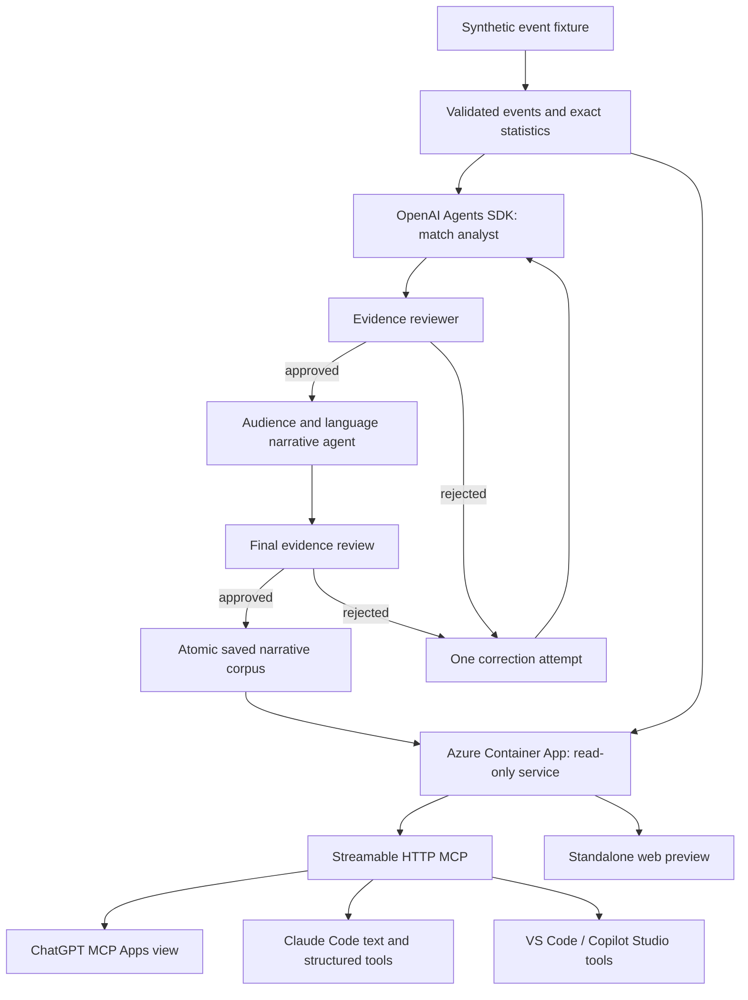

# Architecture

Generation and serving have separate lifecycles. Azure OpenAI is used by the operator's generation command; the public Container App has no inference key or inference role. Its managed identity can only pull the container image from MatchLens's registry. The generated image contains synthetic events, approved narrative artifacts and the static UI.

The view runs in the host's MCP Apps sandbox. It calls tools through the host bridge and sends selected event context to the host. It does not talk directly to Azure OpenAI. The standalone preview uses a same-origin REST adapter to the same service functions.

## Design choices

A simple deterministic renderer would suffice for statistics. The Agents SDK is used where language interpretation, evidence review and audience adaptation provide value. Python computes all numerical summaries so generated arithmetic is not the source of truth.

MCP is the interoperability boundary, not a new custom connector per model vendor. The model used by the surrounding host may differ from the Azure GPT-6 model that generated saved narratives. Claude Code is a client of the same tools; MatchLens does not require the Claude Agent SDK. Copilot Studio is another client; this MVP does not require Microsoft Agent Framework.

The new repository and Azure resource group allow a later Dhisana adapter without coupling deployments, customer data, authentication or production databases. No current app instance inside Dhisana is required.

## Known limitations

- Synthetic event positions are not tracking. No reliable possession, xG, speed, off-ball movement or causal tactical conclusions can be derived.
- Two time windows have saved AI narratives; other valid windows return statistics-only results.
- Narrative languages are English and Spanish. Most navigation labels remain English.
- Model reviewers can still miss errors. Schema and citation checks guarantee structure and valid references, not truth of every sentence.
- The reference bridge harness validates messaging, not vendor-specific deployment or rendering policies.
- No tenant data, OAuth, licensed data ingestion, continuously running agents or live commentary is implemented.
